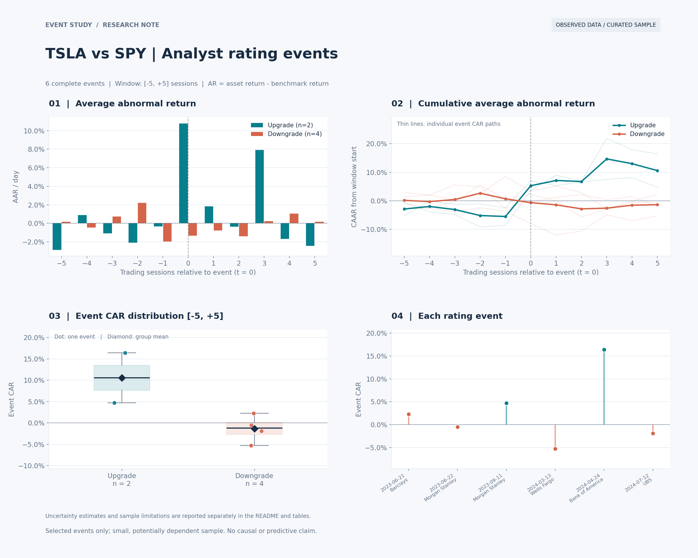
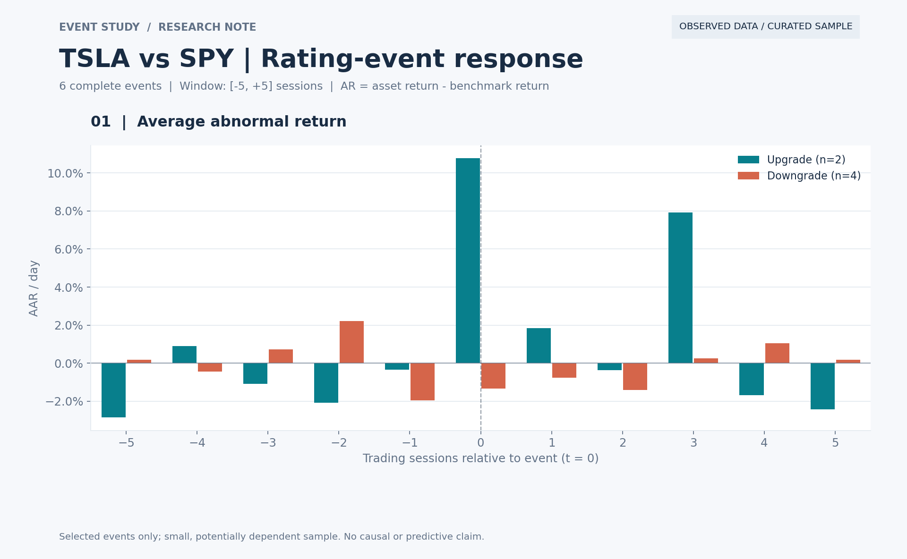
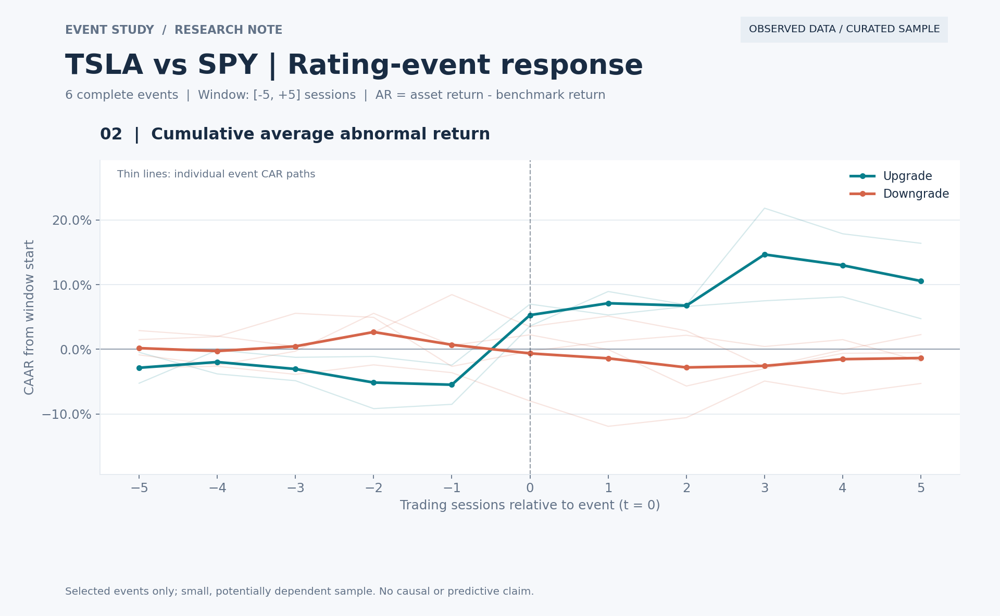
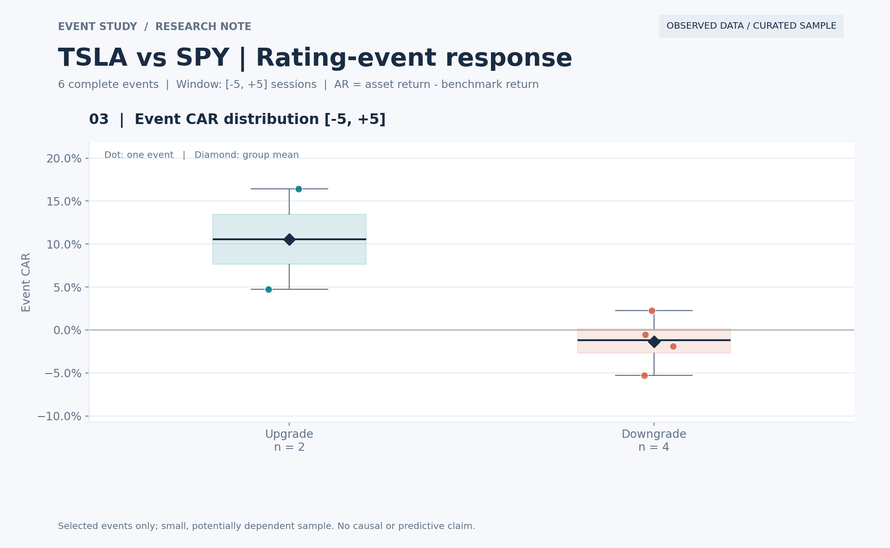
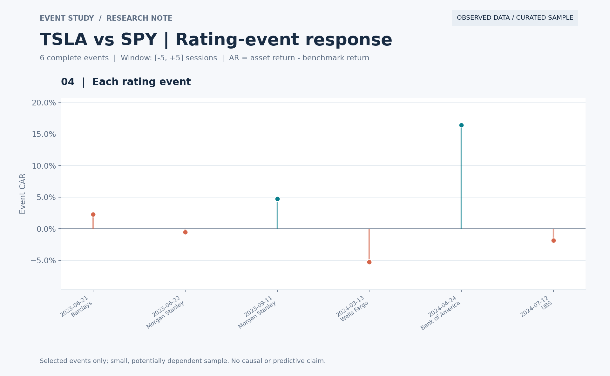

# Event Study｜分析师评级变动与股票异常收益

## 背景

分析师评级调整为研究股票市场对公开信息的反应提供了一个具体场景。评级变化前后的股价表现，也可能受到整体市场走势、公司财报及其他同期消息的影响。因此，研究需要结合市场基准、事件时间和样本差异，观察股票在评级调整前后的相对表现。

## 研究目的

本项目使用市场调整法计算异常收益（AR）和累计异常收益（CAR），衡量评级事件前后的股票相对收益，比较上调与下调两组的收益路径，并通过样本统计评估观测结果的不确定性。同时，建立从原始数据、事件对齐到图表输出的可复现流程，为进一步扩展样本和检验评级信息的预测能力提供基础。

当前提供一个可离线复现的真实案例：**TSLA 股票、SPY 基准，以及 2023—2024 年的 6 次分析师评级调整**。另保留固定随机种子的模拟案例，方便检查程序和理解图形。

> 真实案例是有公开出处的手工精选样本，包含 2 次上调、4 次下调，并非完整评级数据库。图表用于展示研究流程和观测结果，不代表已验证的交易策略或评级变化的因果效果。



## 快速运行

在项目根目录运行，建议使用 Python 3.10 或以上版本：

```bash
python -m pip install -r requirements-viz.txt

# 从随附原始快照生成收益表和评级事件表，无需联网
python prepare_real_example.py

# 运行真实案例，输出图表、逐事件结果与统计汇总
python visualize.py --returns data/real/returns.csv --events data/real/events.csv --label "TSLA vs SPY" --output-dir docs/real

# 运行计算正确性和数据校验测试
python -m unittest discover -s tests -v
```

真实案例的图片保存在 `docs/real/figures/`，计算结果保存在 `docs/real/tables/`。当前预览在 Python 环境中实际运行生成；14 项测试通过。验证环境为 pandas 2.2.2、NumPy 1.26.4、Matplotlib 3.8.4、SciPy 1.13.1。

如需重新获取行情，可显式执行 `python prepare_real_example.py --download`。下载接口和历史调整值可能变化；复现本页数值请使用随附快照。该命令只下载行情，评级记录仍来自本项目逐条整理的公开资料。

## 真实数据与事件样本

### 行情数据

- 标的：[TSLA（Yahoo Finance）](https://finance.yahoo.com/quote/TSLA/history/)；市场代理：[SPY（Yahoo Finance）](https://finance.yahoo.com/quote/SPY/history/)。
- 实际日期：**2023-01-03 至 2024-12-31，共 502 个匹配交易日**。
- 原始资料：保留 Yahoo 原始 JSON 响应，以及解析后的开、高、低、收、成交量与调整后收盘价。
- 收益口径：分别对 TSLA、SPY 的调整后收盘价计算日简单收益。第一行无前值，保留为空；其余 501 行收益完整。
- 可追溯性：抓取时间、请求地址、文件哈希、处理公式见 [数据清单](data/real/source_manifest.json)。

### 评级变动

| 对齐交易日 | 机构 | 原评级 → 新评级 | 方向 |
|---|---|---|---|
| 2023-06-21 | Barclays | Overweight → Equalweight | 下调 |
| 2023-06-22 | Morgan Stanley | Overweight → Equal Weight | 下调 |
| 2023-09-11 | Morgan Stanley | Equal-weight → Overweight | 上调 |
| 2024-03-13 | Wells Fargo | Equal Weight → Underweight | 下调 |
| 2024-04-24 | Bank of America | Neutral → Buy | 上调 |
| 2024-07-12 | UBS | Neutral → Sell | 下调 |

每条记录的新闻链接、发布时间核验状态及补充证据见 [数据来源与处理记录](data/real/SOURCES.md)，原始事实字段见 [评级来源表](data/real/raw/ratings_source_records.csv)。这些是人工整理的事实记录，不是供应商导出的全量评级原始表；只纳入评级方向发生变化的事件。

其中 Morgan Stanley 上调的原报告发布于 **2023-09-10（周日）23:28 UTC**，事件输入保留 09-10，计算时映射到 **09-11**。其他记录保留能够核实的报道/动作日期，不把未知的原研报时刻填成精确时间。

## 研究方法

### 1. 事件窗口与日期对齐

新增可视化流程默认采用 **[-5, +5] 个交易日**，合计 11 个交易日；`t = 0` 为事件对应的交易日。非交易日映射到不早于输入日期的首个交易日，最多允许顺延 7 个自然日。

代码按输入收益表的交易日期索引取窗口，不自行推测交易所节假日。自行导入数据时，应提供完整交易日序列；缺失报价应保留为缺失值，不能删去日期后把相邻交易日拼接。盘后公告需要事先将事件日期对齐到下一交易日，程序不会自动识别公告时段。

窗口不完整或包含缺失/无穷收益的事件会被排除，并写入 `excluded_events.csv`；重复日期、重复事件等输入问题会报错。当前真实案例 6 条事件全部保留。

### 2. 异常收益与累计收益

市场调整法：用 TSLA 的收益减去同期 SPY 的收益，衡量它相对市场多涨了多少、少跌了多少。

**1. 先计算每日收益率**

使用调整后收盘价，分别计算 TSLA 和 SPY 的日收益：

$$
R_t=\frac{当天调整后收盘价}{前一交易日调整后收盘价}-1
$$

例如，价格从 100 涨到 103，当日收益就是 **3%**。

**2. 异常收益 AR：当天相对市场的收益差**

$$
AR_t=R_{\text{TSLA},t}-R_{\text{SPY},t}
$$

如果 TSLA 当天涨 **3%**，SPY 涨 **1%**：

$$
AR_t=3\%-1\%=2\%
$$

表示 TSLA 当天比基准多涨了 **2 个百分点**。“异常”在这里仅表示相对基准的差额，并不意味着统计上显著。

**3. 累计异常收益 CAR：把窗口内每天的 AR 加起来**

$$
CAR[a,b]=\sum_{t=a}^{b}AR_t
$$

下面仅为计算示例：

| 相对事件日 | TSLA 日收益 | SPY 日收益 | 当日 AR | 截至当日的 CAR |
|---:|---:|---:|---:|---:|
| −1 | +1.0% | +0.5% | +0.5% | +0.5% |
| 0 | +3.0% | +1.0% | +2.0% | +2.5% |
| +1 | −2.0% | −0.5% | −1.5% | +1.0% |

所以这个三日窗口的 CAR 为：

$$
CAR[-1,+1]=0.5\%+2.0\%-1.5\%=\boxed{1.0\%}
$$

你的实际实验使用 **[-5,+5]，共 11 个交易日**：先为每次评级事件计算这 11 天的 AR，再加总得到该事件的 CAR。最后把两次上调事件的 CAR 取平均，得到前面看到的 **+10.57%**。

需要注意：**CAR 是每日异常收益的加总，不是复利投资收益；它也不能单独证明这些收益由评级调整造成。**

### 3. 样本统计与不确定性

对每组完整窗口 CAR 计算样本量、均值、标准差、双侧单样本 t 检验和 95% t 置信区间。CAAR 的逐点区间由**各事件累计路径的横截面离散程度**计算，不把每天的置信区间相加。计算形式与 [SciPy 单样本 t 检验说明](https://docs.scipy.org/doc/scipy/reference/generated/scipy.stats.ttest_1samp.html)一致。

样本少于 2 个或方差为零时，检验和区间返回缺失值。这里的 t 区间假定事件独立，不是同时置信带，也未对重叠窗口或相关性作修正。真实样本不充分满足这些条件，因此这部分主要展示统计计算，而非稳健推断。

## 运行结果与图形解读

### 图 1：平均异常收益（AAR）



横轴为事件前后交易日，纵轴为当日平均异常收益。上调组在事件日出现明显正值；但这一组只有 2 次事件，其中 2024-04-24 同时受到财报与业务消息影响，不能把柱形高度全部归因于评级调整。

### 图 2：累计平均异常收益（CAAR）



粗线是分组平均累计路径，细线是每条事件自身的累计路径。细线保留个体差异，避免只看均值忽略样本分散程度。两组的事件前收益也并非完全平稳，这提醒我们关注事件选择和同期市场信息。

### 图 3：完整窗口 CAR 分布



每个点代表一次评级事件，菱形为组均值，箱体显示样本分布。上调组仅有 2 个点，箱线图只提供描述；下调事件也并非全部得到负 CAR。

| 方向 | 事件数 | 平均 CAR [-5,+5] | 简化 95% t 区间 | 简化双侧 p 值 |
|---|---:|---:|---:|---:|
| 上调 | 2 | **+10.57%** | [-63.54%, +84.67%] | 0.3211 |
| 下调 | 4 | **−1.35%** | [-6.35%, +3.65%] | 0.4528 |

上调组的区间非常宽，这是样本极少导致的不确定性，不是绘图错误。即使按简化的独立样本计算，两组也都没有达到 5% 显著性水平；重叠与共同消息使其推断还需更加谨慎。完整数值见 [统计汇总 CSV](docs/real/tables/summary.csv)，逐点区间见 [不确定性补充图](docs/real/figures/05_caar_confidence_intervals.png)。

### 图 4：逐事件结果



| 对齐交易日 | 机构 | 方向 | CAR [-5,+5] |
|---|---|---|---:|
| 2023-06-21 | Barclays | 下调 | +2.27% |
| 2023-06-22 | Morgan Stanley | 下调 | −0.52% |
| 2023-09-11 | Morgan Stanley | 上调 | +4.73% |
| 2024-03-13 | Wells Fargo | 下调 | −5.29% |
| 2024-04-24 | Bank of America | 上调 | +16.40% |
| 2024-07-12 | UBS | 下调 | −1.87% |

这些是相应窗口内观测到的市场调整收益，不是“跟随评级交易”的回测绩效。尤其需要注意：2023-06-21 与 06-22 的窗口重叠；2024-04-24 存在财报消息；2024-07-12 紧邻 Robotaxi 延期消息。

## 导入自己的数据

`returns.csv` 必须包含 `Date,ret,mkt`，收益以小数表示；一行对应一个交易日。`events.csv` 必须包含 `event_id,event_date,firm,event_type`，其中类型为 `upgrade` 或 `downgrade`，事件编号不可重复。

```bash
python visualize.py --returns data/local/returns.csv --events data/local/events.csv --label "My sample" --window 3 --output-dir outputs/my_sample
```

上述命令改用 [-3,+3] 个交易日窗口。输出包括逐日事件面板、逐事件 CAR、AAR/CAAR、分组统计、排除原因，以及 5 张单图和 1 张总览。

## 模拟案例

```bash
python visualize.py --demo --seed 42 --output-dir docs/demo
```

模拟案例包含 32 次事件，使用固定随机种子，并**人为注入方向相反的事件冲击**。其日历仅是合成的工作日序列，不是交易所历史日历。它用于离线演示和程序验证，不用于说明真实市场效果。图中统一标注 `SYNTHETIC DEMO`，与真实案例分开存放。

[查看模拟案例总览](docs/demo/figures/overview.png)

## 项目结构

```text
event_study/
├── README.md
├── requirements-viz.txt
├── prepare_real_example.py     # 原始快照 → 收益与评级事件输入
├── event_analysis.py           # 对齐、AR/CAR、AAR/CAAR、样本统计
├── visualize.py                # 命令行绘图与表格导出
├── demo_data.py                # 明确标记的模拟数据
├── data/real/
│   ├── raw/                   # 原始行情 JSON、行情表、评级来源记录
│   ├── returns.csv
│   ├── events.csv
│   ├── SOURCES.md
│   └── source_manifest.json
├── docs/
│   ├── real/                  # 真实案例图、结果表和运行元数据
│   └── demo/                  # 模拟案例图与结果
└── tests/test_event_analysis.py
```

## 后续研究方向

可进一步扩展完整评级样本、准确公告时间、市场模型与多因子基准、重叠事件处理和样本外检验。若接入新闻 NLP 或大模型特征，应另行检验它们是否在既有评级信息之外提供增量解释或预测能力；本版本尚未实现 AI 预测模型。

## 结论

在本次精选的 6 次 TSLA 评级调整中，以 SPY 为基准，在事件前后各 5 个交易日的窗口内（含事件日，共 11 个交易日），2 次上调事件的平均累计异常收益为 **+10.57%**，4 次下调事件为 **−1.35%**。这一结果描述了当前样本中两组相对收益的方向差异。

对各组完整窗口 CAR 均值是否为零进行双侧单样本 t 检验，上调组和下调组的 p 值分别为 **0.3211** 和 **0.4528**。即使采用简化的独立样本假设，两组均未达到 5% 显著性水平；这并不证明评级调整没有影响。此外，样本量较小、部分事件窗口重叠，以及财报等同期消息的干扰，都限制了结果的解释范围。

因此，**当前证据尚不足以确认评级调整具有稳定的收益预测能力，也无法将观测到的异常收益全部归因于评级变化。** 由于计算窗口包含评级公布前的收益，上述数字也不能解释为评级公布后买入所获得的策略回报。本案例完成了可追溯、可复现的事件研究流程；更可靠的结论仍需扩大样本、处理事件相关性与同期消息，并开展样本外检验。
